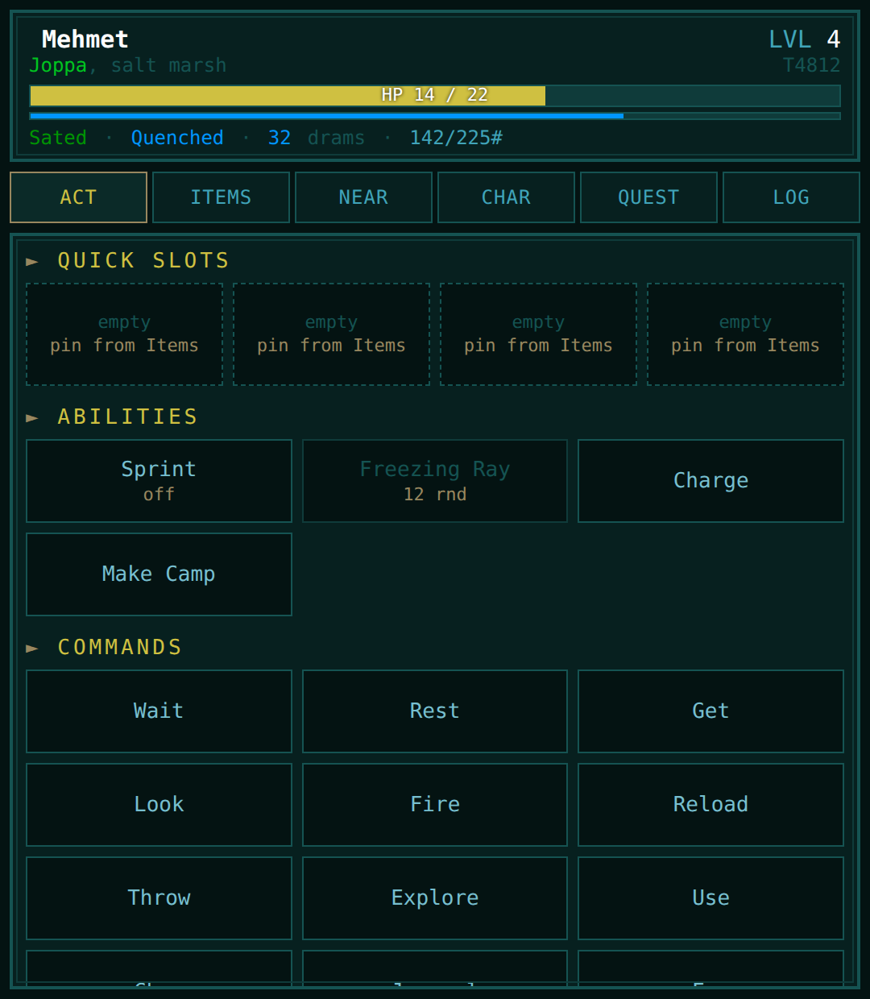
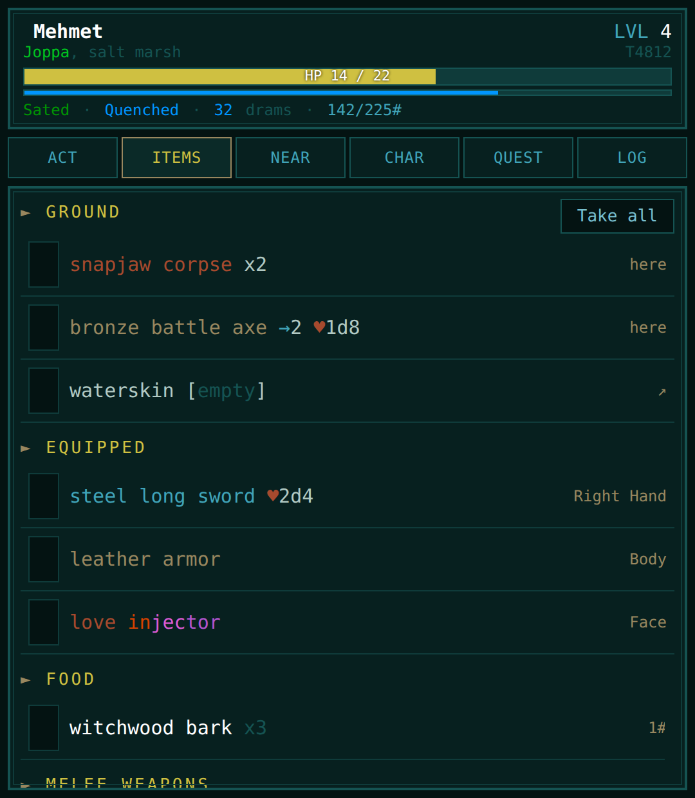
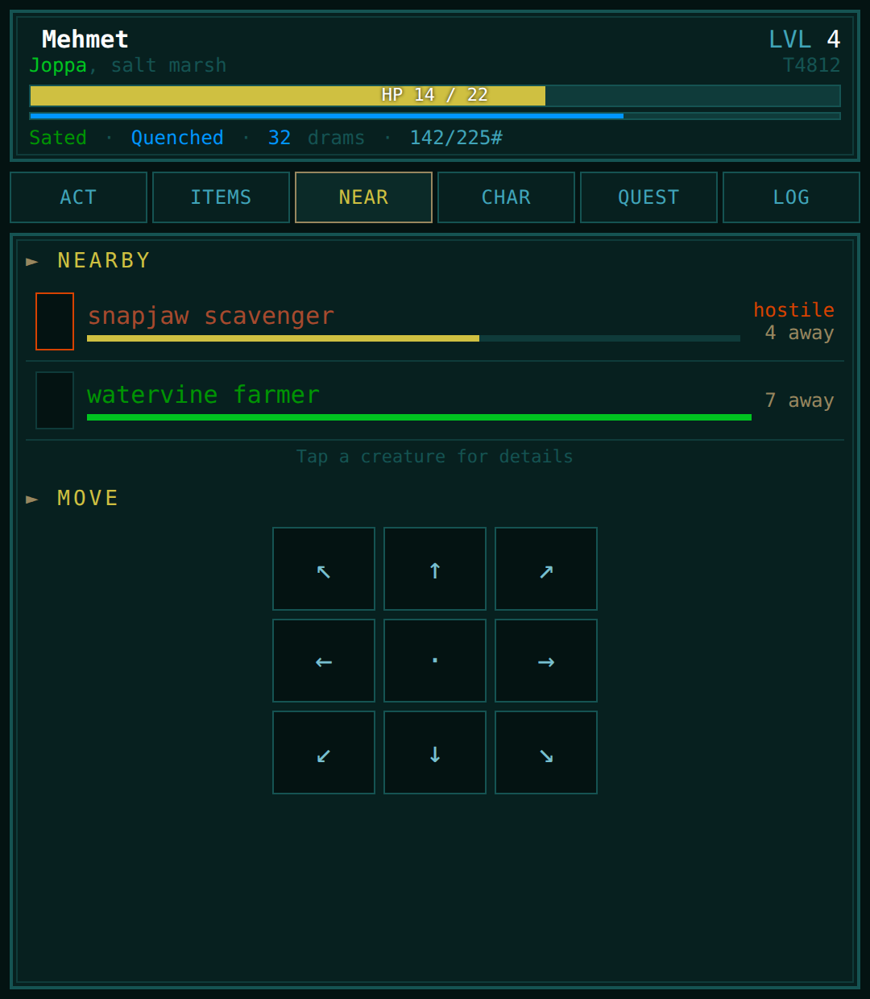
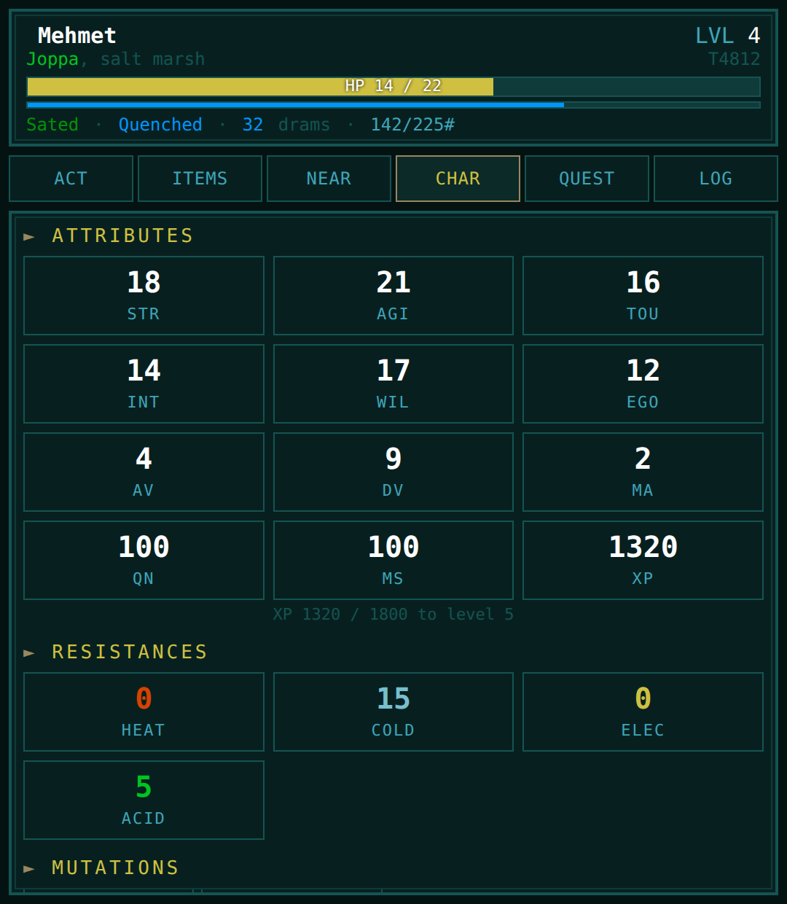
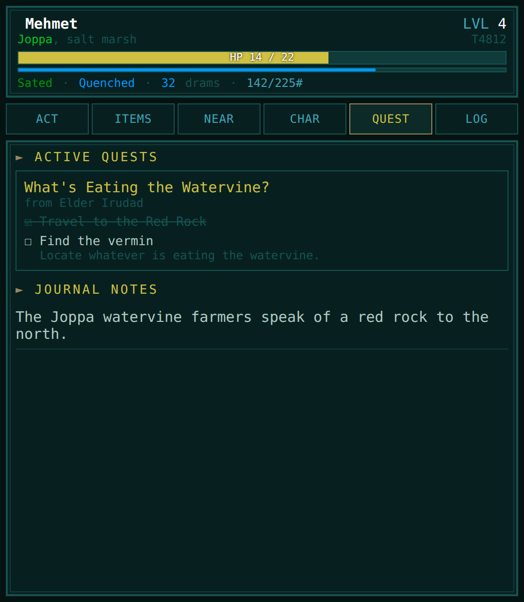
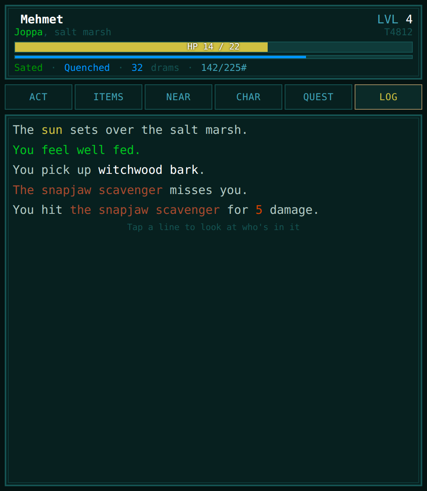

# QudLink

Second-screen companion for **Caves of Qud**. Made for dual-screen handhelds like the AYN Thor: Qud runs on the top screen, and the QudLink app turns the bottom screen into a Qud-styled control panel.

      

## Install

1. Subscribe to the mod on the [Steam Workshop](https://steamcommunity.com/sharedfiles/filedetails/?id=3838966520) and enable it in Qud's Mods menu.
2. Download `QudLink.apk` from the [latest release](https://github.com/UncookedNoodle/QudLink/releases/latest) and install it on the same Android device that runs Qud (allow installs from unknown sources).
3. Start Qud, load a save, then open the QudLink app.

No Android device? With the mod running, open **http://127.0.0.1:8765/** in a browser on the same machine for the same interface.

## Features

- **Act**: abilities with cooldowns/toggles, four pinnable quick slots, common commands
- **Items**: ground items nearby, equipment and inventory with real tiles; tap for actions, hold to describe
- **Near**: visible creatures with HP, plus a movement pad
- **Char**: attributes, mutations, skills, effects, low-HP alert
- **Quest** and **Log** tabs

## Layout

- `mod/`: the Qud mod (`QudLink.cs`, `manifest.json`); `mod/ui/` is a copy of `app/assets/` that the mod serves to browsers
- `app/`: the Android app (a WebView around `app/assets/`)
- `setup-sdk.sh` / `build-apk.sh`: build the APK without Android Studio

Preview the UI on a PC with fake data: open `app/assets/index.html#demo` in a browser.
